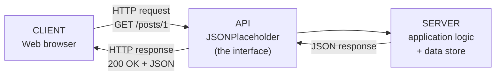

# Phase 01 - API and Client-Server Fundamentals

## Task 01 - Explore an API using a browser

Open each URL in the browser and copy the values from **your own** screen into the table.
(Take the three screenshots listed in `../evidence/README.md`.)

| URL | userId | id | title | body |
| --- | --- | --- | --- | --- |
| https://jsonplaceholder.typicode.com/posts/1 | 1 | 1 | _copy from browser_ | _copy from browser_ |
| https://jsonplaceholder.typicode.com/posts/2 | 1 | 2 | _copy from browser_ | _copy from browser_ |
| https://jsonplaceholder.typicode.com/posts/3 | 1 | 3 | _copy from browser_ | _copy from browser_ |

**Why does the response change for /1, /2 and /3?**
The last part of the URL is the identifier of the resource. `/posts/1`, `/posts/2` and `/posts/3`
ask the server for three different posts, so the server looks up a different record each time and
returns different JSON. The API and the request format stay the same; only the identifier changes.

## Task 02 - Client, API and server



```
Browser  --GET /posts/1-->  API  -->  Server (logic + data)
Browser  <--200 + JSON----  API  <--  Server
```

- **Client:** the browser, which asks for data.
- **API:** the defined interface (URLs, methods, JSON format) the client must use.
- **Server:** the system behind the API that finds the data and builds the answer.
- **Response:** the JSON (and status code) sent back to the client.

**What happens when the browser requests /posts/1?**
The browser sends an HTTP GET request for `/posts/1` to the JSONPlaceholder API. The API receives
the request and passes it to the server, which finds post number 1. The server returns the post,
and the API sends it back as an HTTP response with status 200 and a JSON body. The browser simply
displays that JSON. The browser never needs to know how the server stores or finds the post.

## Task 03 - Identify API resources

| Endpoint | Resource | Specific resource? |
| --- | --- | --- |
| /posts | posts (the whole collection) | No - it means all posts |
| /posts/1 | the post with id 1 | Yes |
| /posts/2 | the post with id 2 | Yes |
